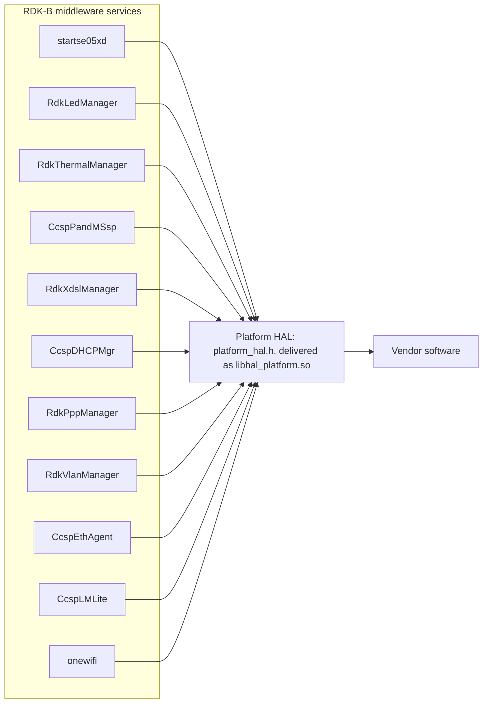
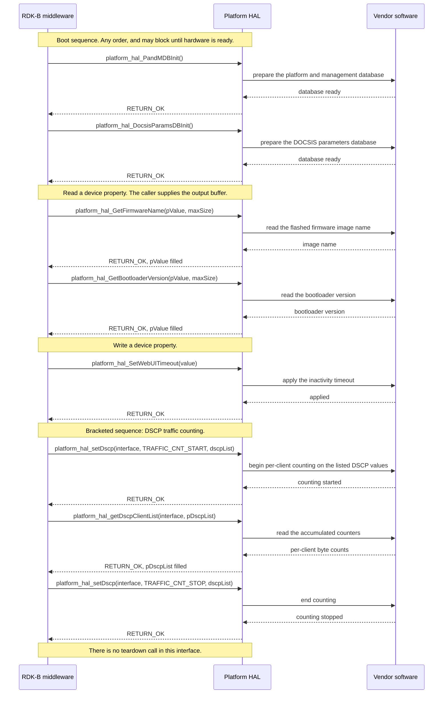

# PLATFORM HAL Documentation

## Version History

| Date | Comment | Version |
| --- | --- | --- |
| 2023-11-08 | Initial Platform HAL interface release under RDKB-52300. | 1.0.0 |
| 2023-11-13 | Repository housekeeping only; the declared interface did not change. | 1.0.1 |
| 2023-11-20 | DHCP option defines extended; header updated for the unified WAN manager under RDKB-52640. | 1.1.0 |
| 2023-12-28 | ECO mode status read added under RDKBDEV-2326. | 1.2.0 |
| 2024-11-25 | PPP username and password reads added under RDKBDEV-2733. | 1.2.1 |
| 2024-11-27 | QoS and traffic management added through `platform_hal_qos_apply`. | 1.3.0 |
| 2024-11-29 | Major version check aligned to `main` under issue #11; `build_ut.sh` updated. | 1.3.1 |
| 2024-11-29 | `platform_hal.h` corrected under issue #23. | 1.3.2 |
| Not stated in the repository changelog | Return value extended for unsupported HAL functions through `RETURN_UNSUPPORTED`, and the thermal manager functions implemented for XB10 and XB9, under RDKB-65287. | 1.3.3 |
| 2026-08-24 | Specification rewritten to the canonical RDK-B HAL topic set. Documentation only: the interface itself is unchanged, so this revision introduces no new release. | 1.3.3 (documentation revision) |

## Acronyms

- `HAL` \- Hardware Abstraction Layer
- `RDK-B` \- Reference Design Kit for Broadband Devices
- `OEM` \- Original Equipment Manufacturer
- `SoC` \- System on a Chip
- `DOCSIS` \- Data Over Cable Service Interface Specification
- `DRAM` \- Dynamic Random Access Memory
- `DSCP` \- Differentiated Services Code Point
- `eMMC` \- embedded MultiMediaCard
- `ECO` \- Energy Conservation Operation, the device power-saving mode
- `LED` \- Light Emitting Diode
- `MACsec` \- Media Access Control Security
- `PandM` \- Platform and Management, the RDK-B provisioning and management database
- `PPP` \- Point-to-Point Protocol
- `PSM` \- Power Saving Mode
- `PWM` \- Pulse Width Modulation
- `QoS` \- Quality of Service
- `RPM` \- Revolutions Per Minute
- `SNMP` \- Simple Network Management Protocol
- `WAN` \- Wide Area Network

*Source: the terms used in this document, expanded against `include/platform_hal.h`.*

## Description

Platform HAL is the RDK-B abstraction over board and device details that belong to no single
subsystem. It is the interface through which RDK-B middleware reads hardware and firmware
identity such as the model name, serial number, base MAC address, hardware revision, software
version, bootloader version and firmware image name; reads flash and DRAM sizing; toggles remote
management surfaces such as Telnet, SSH, SNMP and the web user interface; drives LED, fan and
thermal control; and applies QoS, DSCP traffic counting and MACsec settings. The vendor supplies
the implementation behind it; the interface itself declares no implementation.

Platform HAL has the widest set of dependents of any HAL in this collection. Eleven RDK-B
middleware services reach the hardware through this one interface, so the interface is a fan-in
rather than the single service-to-HAL chain most RDK-B HALs form.



## Optional Components

Every function in this interface is declared unconditionally except the nine gated by the two
compile-time feature flags below. A caller compiled against a header where a flag is undefined
will not see the corresponding declarations at all, so the availability of these functions is a
build-time property rather than a run-time one.

- `FEATURE_RDKB_LED_MANAGER` gates exactly one function,
  `platform_hal_initLed()`. It additionally gates the
  `led_name` and `led_param` members of
  `LEDMGMT_PARAMS`, so the structure a caller populates for
  `platform_hal_setLed` differs in shape between the two builds.
- `FEATURE_RDKB_THERMAL_MANAGER` gates eight functions:
  `platform_hal_initThermal()`,
  `platform_hal_LoadThermalConfig()`,
  `platform_hal_setFanSpeed()`,
  `platform_hal_getFanTemperature()`,
  `platform_hal_getInputCurrent()`,
  `platform_hal_getInputPower()`,
  `platform_hal_getRadioTemperature()` and
  `platform_hal_getEcoModeStatus()`. It also gates the types
  `FAN_SPEED`,
  `THERMAL_PLATFORM_CONFIG` and
  `FAN_ERR`.

## Component Runtime Execution Requirements

### Initialization and Startup

The initialization functions below give the vendor implementation the opportunity to open the
databases it needs, start any internal threads and prepare the hardware. The client is expected to
call them during the boot sequence, and **this interface places no ordering constraint between
them: they may be called in any order.**

- `platform_hal_PandMDBInit()`
- `platform_hal_DocsisParamsDBInit()`
- `platform_hal_initThermal()` \- declared only when
  `FEATURE_RDKB_THERMAL_MANAGER` is defined, so a build without that flag has a two-call
  initialization sequence

Third-party vendors implement these appropriately to meet operational requirements. **This
interface is expected to block if the hardware is not ready.** A caller must therefore treat
initialization as a call that may take an indeterminate time rather than one that returns
promptly.

`platform_hal_initLed()` is an initialization call for the LED
subsystem specifically rather than part of the boot sequence above. It is declared only when
`FEATURE_RDKB_LED_MANAGER` is defined, it reports the path of the vendor's LED configuration file,
and its own documentation directs a caller that receives `RETURN_ERR` from it to treat the LED
subsystem as unavailable and not to call the other LED functions. That is the one initialization
dependency this interface states.

### Threading Model

The interface is not thread safe.

Any module which is invoking the API should ensure calls are made in a thread safe manner. This
interface-level rule applies to every function: a caller must serialise each call against every
other Platform HAL call it makes.

Different third-party vendors are allowed to create internal threads to meet their operational
requirements. In that case the third-party implementation is responsible for synchronizing between
the calls and events and for cleaning up the thread.


### Process Model

All functions in this interface are expected to be called from multiple processes. The interface
provides no cross-process locking, so a vendor implementation protects any shared platform
resource against concurrent entry from more than one process.

### Memory Model

All strings this interface exchanges are zero-terminated. Every output buffer documented in
`include/platform_hal.h` is described as receiving a zero-terminated value, and the buffer minimum
sizes are stated per function on the declaration.

#### Caller Responsibilities

- The caller is responsible for allocating and de-allocating memory for the functions that
  require it, as specified in the API documentation on each declaration.
- Where a function documents a minimum buffer size, the caller must honour it. String accessors that accept a `maxSize` argument also require the caller to pass the actual allocation size; other accessors define no truncation behaviour, so a shorter buffer than documented has no defined protection against an overrun.
- Where a structure is passed in, the caller allocates and owns it; it populates input structures as required by the declaration and provides storage for output structures.
  call has returned**, so a caller keeps the structure valid for the duration of the call, must not
  rely on the pointer being discarded when the call completes, and must confirm the retention
  behaviour with the vendor implementation before handing this interface storage it is about to
  release.
- The same silence governs *erasing* that storage, and the order of the two obligations matters.
  Where a buffer or structure holds a protected value, the clearing requirement under `Logging and
  debugging requirements` is discharged **after** non-retention or release has been established for
  that storage, not when the call returns — overwriting memory an implementation may still be
  reading corrupts that read. Keeping the storage stable and then erasing it are sequential steps,
  not competing rules, and the erasure follows immediately once the first is settled. This applies
  to a caller-allocated **output** buffer as much as to an input structure: every string accessor
  in this interface describes its output as caller-allocated and caller-owned and states that
  retention is not established, so the return of the call is not the moment the buffer becomes free
  to overwrite. A copy the caller made for itself is the exception, because no implementation holds
  a pointer to it.
- One function inverts this and the caller must not miss it:
  `platform_hal_GetMemoryPaths()` allocates a
  `PLAT_PROC_MEM_INFO` array itself and returns it through a
  caller-held pointer, rather than filling a caller-supplied buffer.

#### Module Responsibilities

- Third-party vendors are allowed to allocate memory for their internal operational requirements.
  In that case the third-party implementation is responsible for de-allocating it internally.
- A module must release all internally allocated memory when it terminates or closes its
  connection to the HAL, so that no resource is leaked across a service restart.

### Power Management Requirements

The HAL is not involved in any of the power management operation. Any power management state
transitions MUST not affect the operation of the HAL.

`platform_hal_SetLowPowerModeState()` sets a `PSM_STATE` value and `platform_hal_getEcoModeStatus()`
reports the ECO mode status of a radio module. Both handle power state values only
and do not make the HAL a participant in power management.

### Asynchronous Notification Model

There are no asynchronous notifications. The interface has no callback type or registration
function, so a caller that needs to observe a changing quantity, such as a temperature or an
interface counter, polls the function that reads it.


### Blocking calls

- Every function is synchronous: the calling thread is blocked until the operation completes.
- The initialization functions are expected to block while the hardware is not ready.
- An implementation applies a timeout to any call that can fail through lack of a response.
- `platform_hal_StartMACsec()` and `platform_hal_StopMACsec()` block by design until the start or
  stop operation on the port has an outcome, which may be failure. `platform_hal_StartMACsec()`
  returns once MACsec has started or the operation gives up; its `timeoutSec` argument is
  currently unused and is passed as 0, meaning retry forever. A caller does not invoke either
  function on a latency-sensitive path, checks the return value and, on `RETURN_ERR`, confirms the
  port's state with `platform_hal_GetMACsecOperationalStatus()` before retrying.

### Internal Error Handling

Status-reporting functions return their status synchronously, as the return value. The HAL handles
system errors, such as an out-of-memory condition, internally.

| Code | Value | Meaning | Caller action |
| --- | --- | --- | --- |
| `RETURN_OK` | 0 | The operation completed successfully. | Use the output. |
| `RETURN_ERR` | -1 | The operation failed; no more specific cause is reported. | Discard any output, then retry or report the failure. |
| `RETURN_UNSUPPORTED` | -2 | The platform does not implement the function. Returned only by `platform_hal_setFanSpeed`, `platform_hal_getFanTemperature`, `platform_hal_getInputCurrent`, `platform_hal_getInputPower`, `platform_hal_getRadioTemperature` and `platform_hal_getEcoModeStatus`. | Stop calling the function; the outcome is permanent for the platform. |

Four functions return a reading rather than a status code:

- `platform_hal_getRotorLock()` returns 1 for a locked rotor, 0 for an unlocked rotor and -1 where
  no rotor lock indication is available. The caller reads -1 as unknown, not as a failure, even
  though it equals `RETURN_ERR`.
- `platform_hal_getFanSpeed()`, `platform_hal_getRPM()` and `platform_hal_getFanStatus()` return the
  reading or state directly, so a return of 0 does not distinguish a stopped or disabled fan from a
  failed query.

Four functions do not participate in this scheme at all, and treating their return value as a
status code is an error:

- `platform_hal_getRotorLock()` returns its own discrete codes
  \- 1 for a locked rotor, 0 for an unlocked rotor, and -1 where the platform or the selected fan
  provides no rotor lock indication. The -1 case means "unknown", not "not locked", and must not
  be read as a generic failure even though it shares the numeric value of `RETURN_ERR`.
- `platform_hal_getFanSpeed()`,
  `platform_hal_getRPM()` and
  `platform_hal_getFanStatus()` return a reading or a state
  rather than a status code, and **this interface defines no distinguished value by which any of
  them signals failure.** A caller consequently cannot separate a genuine reading of 0, or a
  disabled fan, from a failed query. That is a property of the interface, not an omission in this
  document, and a caller that needs to detect failure on these three must obtain corroboration
  elsewhere.

### Persistence Model

There is no requirement for the HAL to persist any setting information. The caller is responsible
for persisting any settings related to its own implementation.

## Non functional requirements

The following non functional requirements should be supported by the component.

### Logging and debugging requirements

The component is required to log all error and critical informative messages that help to debug
and triage issues and to understand the functional flow of the system. Logging uses the `syslog`
mechanism; `printf` is discouraged unless `syslog` is unavailable. Logging is consistent across all
HAL components.

Log levels follow the Linux standard logging system, in descending order of severity: `FATAL`, `ERROR`, `WARNING`, `NOTICE`, `INFO`, `DEBUG` and `TRACE`. Each log entry carries a timestamp, the log level and a message describing the event or condition.

Because `RETURN_ERR` carries no cause, the implementation logs the cause of every failure it
detects, including failed fan readings.

Implementations must not log credentials, secrets, security-sensitive information, or other sensitive data.

### Memory and performance requirements

The component should not contribute disproportionately to memory or CPU utilization while
performing normal operations, and its consumption should be commensurate with the operation
requested.

No memory footprint limit is specified for this interface. No numeric limit on resident
memory, on allocation size or on CPU utilization is declared by `include/platform_hal.h` or
anywhere else in this repository, so none is stated here and a caller must not assume one.

Two bounded costs are declared and are the figures a caller can size against. The fixed-capacity
output structure `DSCP_list_t` holds up to 64
`DSCP_Element_t` entries, each holding up to 256
`Traffic_client_t` entries, and the caller allocates the
whole structure including both arrays; that single allocation dominates the memory cost of this
interface. And every string output has a per-function documented minimum buffer size.

### Quality Control

The Platform HAL implementation should pass `Coverity`, `Black Duck` and `Valgrind` checks without
any issue. No memory leak or memory corruption should be introduced by the HAL or by the
underlying third-party software implementation.

### Licensing

The Platform HAL implementation is expected to be released under the Apache License 2.0. The
licence text delivered with this repository is reachable from this documentation set as its
licence and copying pages, with the attribution notice as its notice page. All three are listed
under the generated site's related pages and are delivered at the repository root.

### Build Requirements

The source code should be built under the Linux Yocto environment and should be delivered as a
shared library named `libhal_platform.so`.

To use the Platform HAL capabilities from a component or process:

1. Include `platform_hal.h`, which carries all function prototypes and datatype definitions for
   this interface.
2. Add a linker dependency on `libhal_platform.so`.


### Variability Management

Any new function introduced into this interface should be implemented by all third-party modules,
and the RDK generic code should be compatible with a specific version of the HAL software.

Each interface is versioned using [Semantic Versioning 2.0.0](https://semver.org/spec/v2.0.0.html), and the vendor
code complies with a specific version of the interface. Note the limitation recorded under
**Version History**: the version applies to the released interface, and this header declares no
version macro, so the version cannot be tested from code.


### Platform or Product Customization

The product can be configured through the following compile-time defines:

```c
FEATURE_RDKB_LED_MANAGER
FEATURE_RDKB_THERMAL_MANAGER
```

The effect of each flag on the declared surface is enumerated under **Optional Components**,
including the asymmetry that leaves the fan readings and the two non-initializing LED functions
unconditional. Beyond these two flags, product variation is carried in the *values* this interface
reports rather than in its shape: the model name, router region, hardware version, factory partner
identifier and factory cable-modem variant are all read through it, and the LED colour set, the
fan count and the thermal thresholds are all documented as vendor or OEM specific.


## Interface API Documentation

All function prototypes and datatype definitions for this interface are declared in
`platform_hal.h`. The Doxygen comment on each declaration carries the per-function reference:
argument ranges, buffer ownership and minimum sizes, return values
and their meaning.

### Theory of operation and key concepts

Platform HAL is a flat, stateless-to-the-caller function interface. There is no handle, no session
and no object a caller creates or destroys. A caller includes the header, links the library,
performs the boot-time initialization calls, and thereafter calls individual functions that each
read or set one platform property. Almost every function is a getter or a setter over a single
quantity; the exceptions are the DSCP traffic-counting group, which accumulates counters between a
start and a stop, and the MACsec group, which starts and stops a protocol on a port.

The interface divides into two behavioural kinds, and the distinction matters more than the
functional grouping does:

- **Status-reporting functions** return `RETURN_OK`, `RETURN_ERR` or, for six thermal functions,
  `RETURN_UNSUPPORTED`, and deliver their result through an output argument. Sixty-seven of the
  seventy-one functions are of this kind.
- **Value-returning functions** return the reading itself and have no separate status channel.
  These are `platform_hal_getFanSpeed`, `platform_hal_getRPM`, `platform_hal_getFanStatus` and
  `platform_hal_getRotorLock`. Only the last of these defines a value meaning "not applicable";
  the other three define no failure value at all. See **Internal Error Handling**.

#### Object Lifecycles

- **Creation.** This interface creates nothing on the caller's behalf and exposes no object
  identity. The three boot-time initialization functions prepare vendor-internal state; they
  return no handle, and nothing a caller holds refers to that state.
- **Usage.** The caller allocates the structures the interface fills \-
  `LEDMGMT_PARAMS`,
  `THERMAL_PLATFORM_CONFIG`,
  `FW_BANK_INFO`,
  `INTF_STATS`,
  `DSCP_list_t`,
  `hal_network_params_t` \- and owns them for their whole
  lifetime. The implementation reads or fills them during the call; whether it retains the pointer
  afterwards is not stated by this interface, so a caller keeps each structure valid for as long as
  it uses this interface rather than assuming the pointer is discarded when the call returns.
- **Destruction.** The caller de-allocates what it allocated. **There is no teardown,
  deinitialization or close function in this interface**, so the vendor-internal state established
  at initialization persists for the lifetime of the process and is not releasable through this
  interface. A caller must not look for a counterpart to the initialization calls.
- **Identifiers.** The interface addresses hardware by small integer index rather than by object
  identity: a fan index, an Ethernet port number, a radio index, a processor selected by
  `RDK_CPUS`, a firmware bank selected by
  `FW_BANK` and a WAN interface selected by
  `WAN_INTERFACE`.

#### Method Sequencing

- **Initialization first:** The calls listed under `Initialization and Startup` precede all
  others, and a caller performs the full initialization sequence for its build.
- **Paired sequences:** `platform_hal_setDscp` with `TRAFFIC_CNT_START` begins traffic counting,
  `platform_hal_getDscpClientList` reads the accumulated counters, `platform_hal_resetDscpCounts`
  clears them and `platform_hal_setDscp` with `TRAFFIC_CNT_STOP` ends counting.
  `platform_hal_StartMACsec` and `platform_hal_StopMACsec` bracket MACsec operation on a port.
  `platform_hal_LoadThermalConfig` supplies the default thresholds a caller may then apply.
- **Other calls:** Everything else is order-independent once initialization has completed,
  subject to the serialisation the `Threading Model` requires.

#### State-Dependent Behavior

- **Configuration progress:** A caller reads `platform_hal_GetDeviceConfigStatus()` to decide
  whether configuration-dependent work may proceed.
- **Administrative against operational state:** `platform_hal_GetMACsecEnable` reports the
  administrative setting and `platform_hal_GetMACsecOperationalStatus` reports whether MACsec is
  actually configured at the interface or driver level. The two can legitimately disagree, and a
  caller that needs the state of the link reads the operational one.
- **Readings change with hardware state:** The fan, temperature, current, power and interface
  statistics functions return values that depend on the platform's condition at the time of the
  call.
- **Build state changes the surface:** Nine functions are absent when their feature flag is
  undefined (see `Optional Components`), and six thermal functions may return
  `RETURN_UNSUPPORTED` even when declared (see `Internal Error Handling`).


### Data Structures and Defines

The types below are the ones a caller must construct or interpret, because they appear in the
signatures of this interface. Each is declared in `include/platform_hal.h`.

**Status codes.** Returned by the sixty-seven status-reporting functions; see **Internal Error
Handling** for which function returns which.

| Define | Value | Meaning |
| --- | --- | --- |
| `RETURN_OK` | 0 | The operation completed successfully. |
| `RETURN_ERR` | -1 | The operation failed; no cause is reported. |
| `RETURN_UNSUPPORTED` | -2 | The platform does not implement the function. Permanent; six thermal functions only. |

**Primitive type aliases.** This interface expresses its signatures in aliases rather than in the
underlying C types, so a caller reading a declaration needs them:
`CHAR` for `char`,
`UCHAR` for `unsigned char`,
`BOOLEAN` for `unsigned char` carrying
`TRUE` or `FALSE`,
`INT` for `int`,
`UINT` for `unsigned int`,
`ULONG` for `unsigned long`, and the fixed-width aliases
`UINT8_t`,
`UINT16_t`,
`UINT32_t` and
`UINT64_t`.
`ENABLE` is also defined, and its own comment records that no
declaration in the header refers to it.

**Buffer and capacity limits.** `FW_NAME_MAX_LEN` 64 and
`FW_STATE_MAX_LEN` 64 size the firmware bank strings;
`PLAT_PROC_MEM_MAX_LEN` 40 sizes each memory path string;
`LED_BUFFER_SIZE` 3 is the number of LED entries a caller
may address. Functions that write a string into a caller buffer state their own minimum size on
the declaration rather than through a macro.

**DHCP option codes.** `DHCPV6_OPT_3` onwards and the
DHCPv4 set ending at `DHCPV4_OPT_END`, value 255, are the
codes carried in the `dhcp_opt` member of `dhcp_opt_list`. `DHCPV4_OPT_END` is the sentinel used
to check whether an option is valid.

**Enumerations and structures.** 

| Type |  What it represents |
| --- |  --- |
| `RDK_CPUS` |  Processor selector: `HOST_CPU`, `PEER_CPU`, `NOT_SUPPORTED_CPU`. Argument to `platform_hal_GetMemoryPaths`. |
| `PLAT_PROC_MEM_INFO` |  DRAM and three eMMC storage paths for one processor, each bounded by `PLAT_PROC_MEM_MAX_LEN`. Allocated by the HAL, not by the caller. |
| `LED_COLOR` |  LED colour selector, from `LED_WHITE` through the combined colours to `NOT_SUPPORTED`. |
| `LEDMGMT_PARAMS` | LED configuration: colour, state \- solid or blink \- and blink interval in seconds. Its `led_name` and `led_param` members exist only when `FEATURE_RDKB_LED_MANAGER` is defined. |
| `FAN_SPEED` | Discrete fan speed setting: `FAN_SPEED_OFF`, `FAN_SPEED_SLOW`, `FAN_SPEED_MEDIUM`, `FAN_SPEED_FAST`, `FAN_SPEED_MAX`. Thermal flag only. |
| `THERMAL_PLATFORM_CONFIG` | Platform fan configuration: fan count, the three temperature thresholds, minimum run time, monitoring delay, power monitoring and log interval. Thermal flag only. |
| `FAN_ERR` | Fan operation error state: `FAN_ERR_NONE`, `FAN_ERR_HW`, `FAN_ERR_MAX_OVERRIDE_SET`. Thermal flag only. |
| `dhcp_opt_list` | Singly linked list node carrying one DHCPv4 or DHCPv6 option code and its value. |
| `PSM_STATE` | Power saving mode state: `PSM_UNKNOWN`, `PSM_AC`, `PSM_BATT`, `PSM_HOT`, `PSM_COOLED`, `PSM_NOT_SUPPORTED`. Data-model state only. |
| `WAN_INTERFACE` | WAN interface selector for DSCP traffic counting: `DOCSIS`, `EWAN`. |
| `TRAFFIC_CNT_COMMAND` | Start or stop selector for DSCP traffic counting: `TRAFFIC_CNT_START`, `TRAFFIC_CNT_STOP`. |
| `Traffic_client_t` | Byte counters for one client against a single DSCP value, with the client MAC address. |
| `DSCP_Element_t` | One DSCP value with its client count and a fixed array of up to 256 client entries; only the first `numClients` are meaningful. |
| `DSCP_list_t` | Complete DSCP counting result for one WAN interface: up to 64 elements, of which only the first `numElements` are meaningful. |
| `FW_BANK` | Firmware bank selector: `ACTIVE_BANK`, `INACTIVE_BANK`. |
| `FW_BANK_INFO` | Firmware image name and trial-boot state for one bank, as zero-terminated strings. |
| `INTF_STATS` | Packet and byte counters for one network interface, covering LAN-to-WAN and WAN-to-LAN traffic only. |
| `ip_version_t` | IP version selector for QoS parameters: `IP_VERSION_IPV4`, `IP_VERSION_IPV6`. |
| `net_proto_t` | Transport protocol selector for QoS parameters: `PROTOCOL_TCP`, `PROTOCOL_UDP`. |
| `hal_network_params_t` | The QoS and traffic management parameter set: source and destination MAC and IP addresses, ports, protocol and DSCP value. |

Each of these types also carries a pointer alias where the interface uses one, for example
`PLEDMGMT_PARAMS`, `PPLAT_PROC_MEM_INFO`, `PPSM_STATE`, `PFW_BANK_INFO`, `PINTF_STATS`,
`pDSCP_list_t`, `pDSCP_Element_t` and `pTraffic_client_t`. The member-level meaning and the valid
range of every field are documented on the member itself in `include/platform_hal.h`.

**This interface declares no callback typedef and no callback registration function**, so there is
no notification type to document here. See **Asynchronous Notification Model**.

### API Surface

The complete declared surface of this interface is the seventy-one functions below, every one of
them named here by its exact identifier. Sixty-seven return `INT`,
two return `UINT`, one returns `BOOLEAN` and one returns lowercase `int`; **no function in this
interface returns `void`.** The nine functions marked *flag* are declared only when their feature
flag is defined, as set out under **Optional Components**.

**Boot-time initialization:**

| Function | Purpose |
| --- | --- |
| `platform_hal_PandMDBInit()` | Initialises the Platform and Management database. |
| `platform_hal_DocsisParamsDBInit()` | Initialises the DOCSIS parameters database. |

**Device configuration status and remote management:**

| Function | Purpose |
| --- | --- |
| `platform_hal_GetDeviceConfigStatus()` | Reports how far the device has progressed through its configuration sequence. |
| `platform_hal_GetTelnetEnable()` | Reports whether Telnet access is currently enabled. |
| `platform_hal_SetTelnetEnable()` | Enables or disables Telnet access. |
| `platform_hal_GetSSHEnable()` | Reports whether SSH access is currently enabled. |
| `platform_hal_SetSSHEnable()` | Enables or disables SSH access. |
| `platform_hal_GetSNMPEnable()` | Reports which interface scope SNMP is currently enabled for. |
| `platform_hal_SetSNMPEnable()` | Selects the interface scope SNMP is enabled for. |
| `platform_hal_SetSNMPOnboardRebootEnable()` | Allows or suppresses SNMP-initiated reboots during onboarding. |
| `platform_hal_GetWebUITimeout()` | Reports the configured web user-interface inactivity timeout. |
| `platform_hal_SetWebUITimeout()` | Sets the web user-interface inactivity timeout. |
| `platform_hal_GetWebAccessLevel()` | Reads the web access level granted to a user on an interface. |
| `platform_hal_SetWebAccessLevel()` | Sets the web access level granted to a user on an interface. |

**Device and firmware identity:**

| Function | Purpose |
| --- | --- |
| `platform_hal_GetModelName()` | Reads the device model name. |
| `platform_hal_GetRouterRegion()` | Reads the regulatory region the router is provisioned for. |
| `platform_hal_GetSerialNumber()` | Reads the device serial number. |
| `platform_hal_GetHardwareVersion()` | Reads the hardware revision of the device. |
| `platform_hal_GetSoftwareVersion()` | Reads the software version currently flashed on the device. |
| `platform_hal_GetBootloaderVersion()` | Reads the bootloader version currently flashed on the device. |
| `platform_hal_GetFirmwareName()` | Reads the name of the firmware image flashed on the device. |
| `platform_hal_GetBaseMacAddress()` | Reads the base MAC address of the device. |
| `platform_hal_GetFirmwareBankInfo()` | Reads the firmware image name and state held in a given bank. |

**Flash and memory inventory:**

| Function | Purpose |
| --- | --- |
| `platform_hal_GetHardware()` | Reads the total flash size of the device in megabytes. |
| `platform_hal_GetHardware_MemUsed()` | Reads the used flash size of the device in megabytes. |
| `platform_hal_GetHardware_MemFree()` | Reads the available flash size of the device in megabytes. |
| `platform_hal_GetTotalMemorySize()` | Reads the total DRAM size of the device in megabytes. |
| `platform_hal_GetUsedMemorySize()` | Reads the DRAM currently in use, in megabytes. |
| `platform_hal_GetFreeMemorySize()` | Reads the DRAM currently free, in megabytes. |
| `platform_hal_GetMemoryPaths()` | Reads the DRAM and eMMC storage paths of a given processor. Allocates its own output. |
| `platform_hal_GetCPUSpeed()` | Reads the processor speed in bogomips. |

**Factory state, reset and image validity:**

| Function | Purpose |
| --- | --- |
| `platform_hal_GetFactoryResetCount()` | Reads how many times the device has been factory reset. |
| `platform_hal_ClearResetCount()` | Clears the factory reset counter. |
| `platform_hal_getTimeOffSet()` | Reads the device's time offset from UTC. |
| `platform_hal_SetDeviceCodeImageTimeout()` | Sets the hardware watchdog timeout. |
| `platform_hal_SetDeviceCodeImageValid()` | Marks the flashed firmware image valid or invalid. |
| `platform_hal_getFactoryPartnerId()` | Reads the factory-programmed partner identifier. |
| `platform_hal_getFactoryCmVariant()` | Reads the factory-programmed cable-modem variant. |
| `platform_hal_setFactoryCmVariant()` | Sets the factory-programmed cable-modem variant. |

**LED control:**

| Function | Purpose |
| --- | --- |
| `platform_hal_initLed()` | *flag* Initialises the LED layer and reports the path of its configuration file. |
| `platform_hal_setLed()` | Applies an LED configuration to the device. |
| `platform_hal_getLed()` | Reads the LED configuration in force at the time of the call. |

**Fan control and readings:**

| Function | Purpose |
| --- | --- |
| `platform_hal_getFanSpeed()` | Reads the PWM-derived speed of a fan. Returns the reading, with no failure value. |
| `platform_hal_getRPM()` | Reads the rotation rate of a fan. Returns the reading, with no failure value. |
| `platform_hal_getRotorLock()` | Reads the rotor lock status of a fan: 1 locked, 0 unlocked, -1 not applicable. |
| `platform_hal_getFanStatus()` | Reads whether a fan is enabled. Returns the state, with no failure value. |
| `platform_hal_setFanMaxOverride()` | Forces a fan to maximum speed, or releases it back to normal control. |
| `platform_hal_setFanSpeed()` | *flag* Sets a fan to one of the platform's discrete speed settings. |

**Thermal, power and ECO mode:**

| Function | Purpose |
| --- | --- |
| `platform_hal_initThermal()` | *flag* Initialises the thermal layer and reports the platform's fan configuration. |
| `platform_hal_LoadThermalConfig()` | *flag* Loads the default thermal thresholds into a configuration structure. |
| `platform_hal_getFanTemperature()` | *flag* Reads the current device temperature. |
| `platform_hal_getInputCurrent()` | *flag* Reads the platform's input current. |
| `platform_hal_getInputPower()` | *flag* Reads the platform's input power. |
| `platform_hal_getRadioTemperature()` | *flag* Reads the temperature of one radio module. |
| `platform_hal_getEcoModeStatus()` | *flag* Reads the ECO mode status of one radio module. |
| `platform_hal_SetLowPowerModeState()` | Sets the platform's power-saving mode state. |

**MACsec:**

| Function | Purpose |
| --- | --- |
| `platform_hal_GetMACsecEnable()` | Reads whether MACsec is enabled on a port, administratively. |
| `platform_hal_SetMACsecEnable()` | Enables or disables MACsec on a port. |
| `platform_hal_GetMACsecOperationalStatus()` | Reads whether MACsec is actually configured at the interface or driver level. |
| `platform_hal_StartMACsec()` | Starts MACsec on a port and waits for the outcome. |
| `platform_hal_StopMACsec()` | Stops MACsec on a port and waits for the outcome. |

**WAN, DHCP options and PPP credentials:**

| Function | Purpose |
| --- | --- |
| `platform_hal_GetDhcpv4_Options()` | Reads the DHCPv4 options the platform requests and sends. |
| `platform_hal_GetDhcpv6_Options()` | Reads the DHCPv6 options the platform requests and sends. |
| `platform_hal_getCMTSMac()` | Reads the MAC address of the CMTS the device is attached to. |
| `platform_hal_GetInterfaceStats()` | Reads packet and byte counters for a named network interface. |
| `platform_hal_GetPppUserName()` | Reads the PPP username configured for the WAN connection. |
| `platform_hal_GetPppPassword()` | Reads the PPP password configured for the WAN connection. |

**DSCP traffic counting and QoS:**

| Function | Purpose |
| --- | --- |
| `platform_hal_setDscp()` | Starts or stops per-client traffic counting for a set of DSCP values. |
| `platform_hal_resetDscpCounts()` | Resets the DSCP traffic counters for a WAN interface. |
| `platform_hal_getDscpClientList()` | Reads the accumulated DSCP traffic counters for a WAN interface. |
| `platform_hal_qos_apply()` | Applies QoS and traffic management settings from a network parameter set. |

### Sequence Diagram

The exchange below uses declared identifiers only. It shows the boot-time initialization, a read,
a write and one of the two bracketed sequences, against the three participants this interface
involves: the caller, the HAL and the vendor software.



### State Diagram

The interface exposes the status values below but does not define the transitions between them,
so no state diagram is drawn. A caller observes these values by polling.

- **Device configuration progress:** `platform_hal_GetDeviceConfigStatus` reports
  `WaitForImplement`, `In Progress` or `Complete`.
- **Power saving mode:** `PSM_STATE` carries `PSM_UNKNOWN`, `PSM_AC`, `PSM_BATT`, `PSM_HOT`,
  `PSM_COOLED` or `PSM_NOT_SUPPORTED`.
- **Fan state:** `platform_hal_getFanStatus` reports enabled or disabled and
  `platform_hal_getRotorLock` the rotor lock status; `FAN_SPEED` enumerates `FAN_SPEED_OFF`,
  `FAN_SPEED_SLOW`, `FAN_SPEED_MEDIUM`, `FAN_SPEED_FAST` and `FAN_SPEED_MAX`; `FAN_ERR` enumerates
  `FAN_ERR_NONE`, `FAN_ERR_HW` and `FAN_ERR_MAX_OVERRIDE_SET`.
- **MACsec state:** `platform_hal_GetMACsecEnable` (administrative) and
  `platform_hal_GetMACsecOperationalStatus` (operational).
- **Firmware bank state:** the `fw_state` member of `FW_BANK_INFO` holds `confirmed` or
  `TrialBoot#0` through `TrialBoot#n`, where the upper bound is vendor specific.
- **ECO mode:** `platform_hal_getEcoModeStatus`, per radio module.
